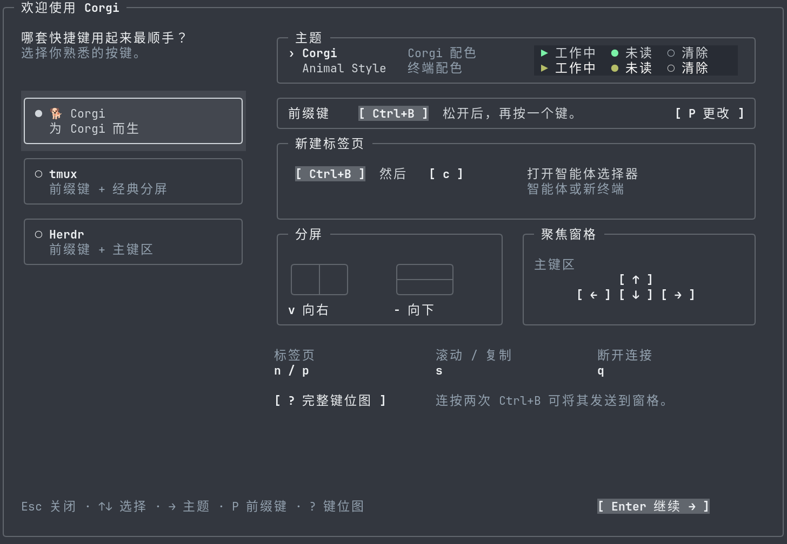
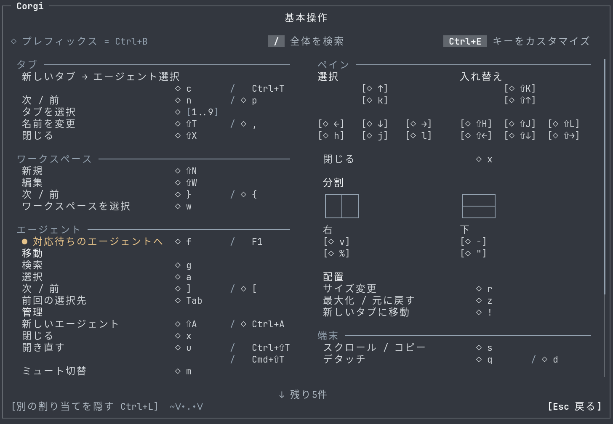
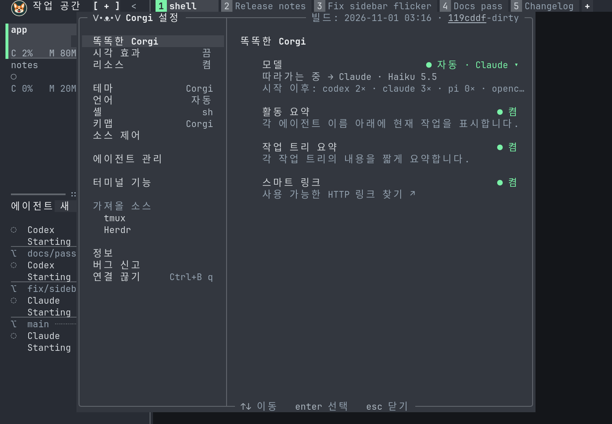
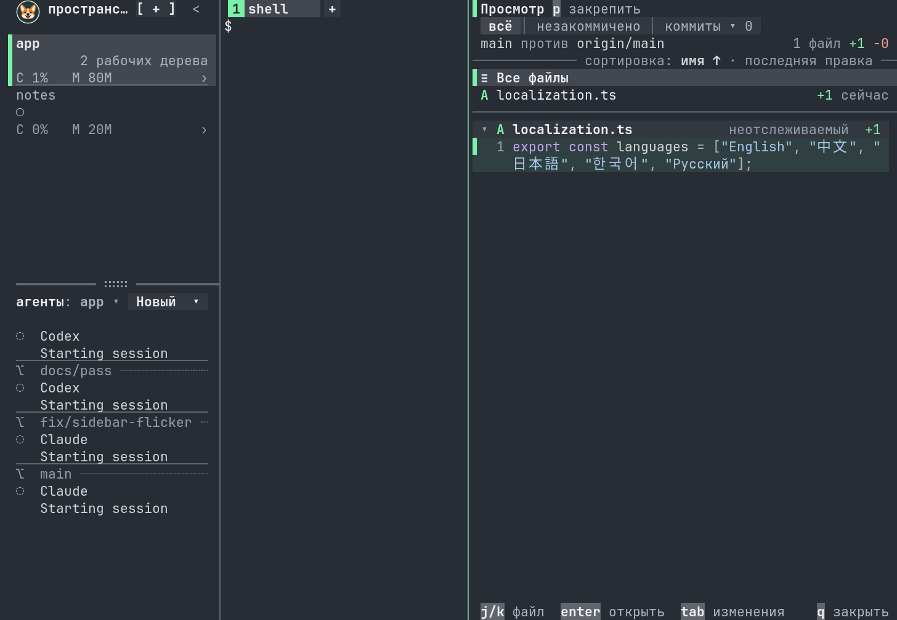
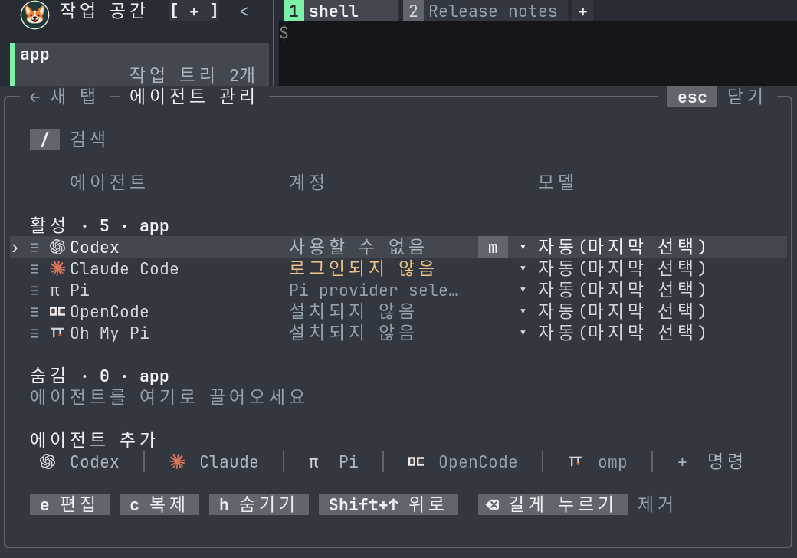

# Localization in Ghostty

These are native-resolution captures of live Ghostty windows on Xvfb, using
the isolated launcher sandbox and its fake agents. Ghostty draws the fonts,
box lines, colors and Kitty graphics. The PNGs are neither scaled nor repainted.
CJK fallback fonts were supplied through an isolated Fontconfig configuration.

Regenerate the full set with Ghostty, Xvfb, xdotool, ffmpeg, and fonts covering
the selected languages installed:

```sh
bun build.ts --no-native
bun tools/i18n_screenshots.ts
# Or only selected languages:
bun tools/i18n_screenshots.ts ja ko
```

The recipe captures welcome, settings, language selection, shortcuts, the
agent picker and agent management at 112×36 and 80×26 cells, plus review at
112×36. Output goes under `dist/i18n-ghostty/`. The images below are a selection.
Each run owns its temporary home, repositories, providers, terminal and display.

Simplified Chinese welcome, 112×36:



Japanese shortcuts, 112×36:



Korean settings, 112×36:



Russian review, 112×36:



Korean agent management, 80×26:


