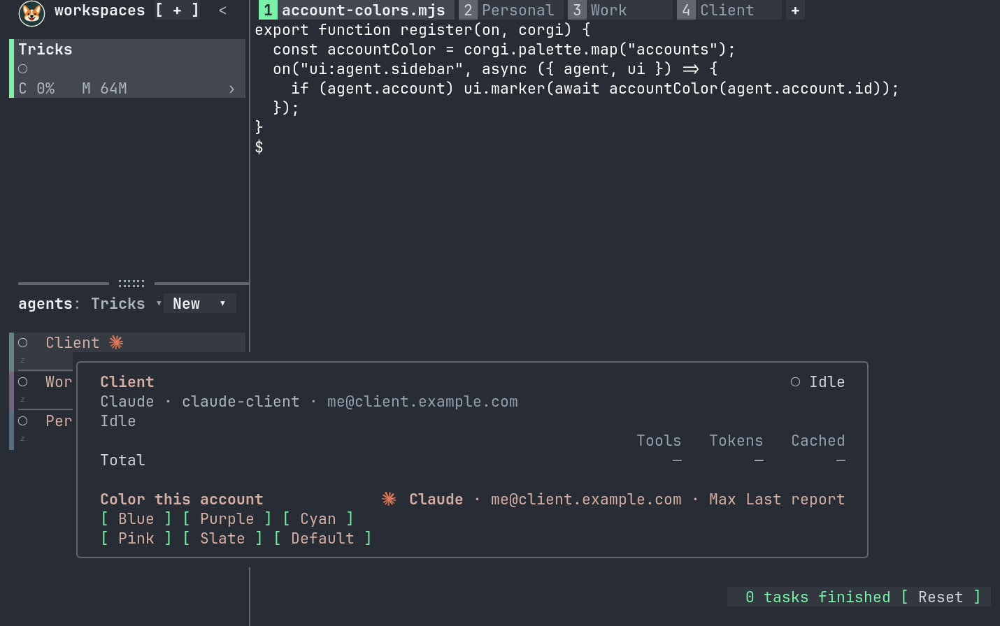
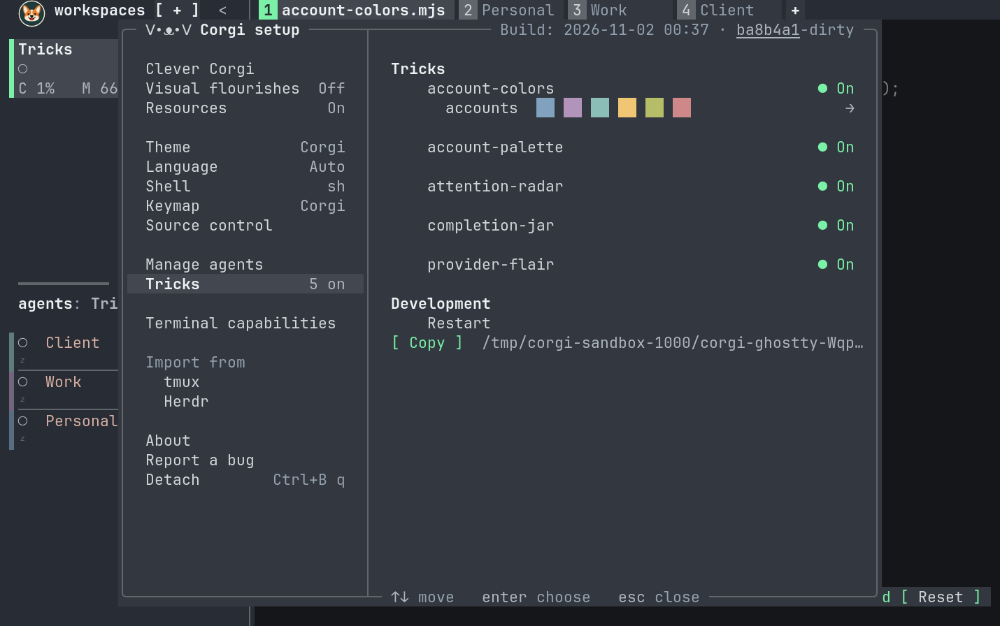

# Corgi Tricks

A trick exports `register(on, corgi)` from a JavaScript or TypeScript file.
Register metadata or named UI callbacks with `on`. UI callbacks edit the existing
drawing with shared operations. Start with strings; opt into rows, columns and
buttons only for the additions that need them.
Corgi runs the file with its bundled runtime: no imports, SDK, npm install,
or separate Node/Bun installation required.

For example, give each account a stable color in the sidebar:

```js
export function register(on, corgi) {
  const accountColor = corgi.palette.map("accounts");
  on("ui:agent.sidebar", async ({ agent, ui }) => {
    if (agent.account) ui.marker(await accountColor(agent.account.id));
  });
}
```

That is the complete [account-colors trick](../examples/tricks/account-colors/main.mjs).
It implements [issue #44](https://github.com/tals/corgi/issues/44): a margin
marker in both flat and grouped sidebars, dim when unfocused and bright when
focused. The key includes the provider and exact account/config folder: two
custom accounts get separate colors, and agents sharing an account match across
workspaces. Assignments survive reloads and restarts. Change the mapping key to
color providers, projects, or other categories. Corgi removes a patch when its
agent disappears or its callback stops drawing. Returning early is enough when
a condition stops matching.

The flat-list marker uses the same `▌` as Corgi's normal focus bar. Here are
three seeded accounts in one workspace, each with its own color:



The accompanying `trick.toml` only identifies and launches the code:

```toml
version = 1
id = "account-colors"
entry = "main.mjs"
```

Use `main.ts` for TypeScript; relative imports work too. Behavior and
subscriptions belong in code.

## Install and try

```sh
./go.ts --sandbox tricks
```

This opens fake agents and the five bundled examples in an isolated world.
To install one in your normal environment:

```sh
mkdir -p "${XDG_CONFIG_HOME:-$HOME/.config}/corgi/tricks"
cp -R examples/tricks/account-colors "${XDG_CONFIG_HOME:-$HOME/.config}/corgi/tricks/"
corgi tricks reload
corgi tricks list
```

Edit the copied code: saves automatically restart only that trick, keeping its
KV store. Atomic editor saves and nested relative imports work. Native file
watchers debounce bursts and reload at most once per second; there is no polling.
Source (`.js`, `.mjs`, `.cjs`, `.ts`, `.mts`, `.cts`, `.jsx`, `.tsx`), JSON and TOML
files trigger reloads. Dependency/build folders, hidden directories and nested
directory symlinks are excluded. Watches are capped at 128 directories and eight
levels. Changes outside this scope require `corgi tricks reload`.

Open **Settings → Tricks** (`prefix i`) to see installed tricks and errors,
enable or disable each trick, toggle **Reload on save**, reload manually, or
copy the install folder. These choices persist per runtime in `settings.json`
and override a manifest's `enabled` value. Disabling immediately clears a trick's
UI but keeps its saved values. A failed trick stays stopped until its source is
edited or it is explicitly restarted. Autoreload errors appear in Settings.



For an agent writing a trick, `corgi --skill tricks` prints the bundled authoring
instructions and examples without connecting to a daemon. The base `corgi --skill`
points agents there for UI customization.

`CORGI_TRICKS_DIR` on the daemon overrides
this directory. Corgi discovers explicitly installed folders, never code in
repositories. Set `enabled = false` in a manifest to start disabled unless Settings overrides it.
Each trick runs once per daemon with its folder as the working directory.

`agent.account` is an object, or `null` when unresolved. Corgi resolves the
provider's profile and login details for both pane and headless agents:

| Field | Meaning |
| --- | --- |
| `id` | Opaque general profile lookup key, including the provider; unchanged by labels or token refreshes |
| `name` | Profile display name |
| `directory` | Canonical profile folder, or `null` for native accounts |
| `loginId` | Corgi's existing internal login identity, or native credential ID; `null` if unknown |
| `email` | Reported email, or `null` |
| `type` | Authentication kind: `"oauth"`, `"api_key"`, `"external"`, or `null` |
| `plan` | Reported plan label, or `null` |
| `usage` | Last account usage reading, or `null` |

Use `id` for profile lookups. Two profile folders can have different IDs while
sharing a `loginId`; use `[agent.provider, agent.account.loginId]` when grouping
by login, and skip unknown logins. Login IDs are opaque and provider-scoped.
They are lookup references, not credentials. `type` describes authentication;
`plan` describes the subscription.

Usage reuses Corgi's existing background account readings, with no extra polling
for Tricks. It describes the account's limits, not an individual agent's token
count. `usage.limits` is `"none"`, `"metered"`, `"rate_limited"`, or
`{ windows: [...] }`. Each non-null window has `used` (percent), nullable
`minutes`, and nullable `reset_at` (Unix seconds). `usage.spend` is nullable and
contains `used_minor`, `limit_minor`, `currency`, `exponent`, `period_start`, and
`reset_at`. `usage.fetched_at` is nullable Unix seconds; check it and
`usage.error` before treating a reading as fresh. `usage.needs_consent` reports
when collection needs consent. Fields stay `null` until Corgi has the data.

The [provider-flair example](../examples/tricks/provider-flair/main.mjs) shows
email, plan, and the last reported usage in the agent's popover.
`corgi rpc '{"op":"session.snapshot"}'` shows this metadata in each pane's
`agent.account`. To color an entire agent type, check `agent.provider`.

## The API

| Call | Effect |
| --- | --- |
| `on(events, callback)` | Register a callback for an event string or array |
| `on(callback)` | Register for `"metadata:*"` |
| `on("ui:agent.sidebar", callback)` | Edit a sidebar row; also `ui:agent.popover` and `ui:agent.pane` |
| `ui.color(color)` | Change the primary text color |
| `ui.marker(color)` | Color the identifying edge or marker |
| `ui.append(content)` | Add inline Markdown or a small layout; Corgi handles placement |
| `ui.text(text, color?)`, `ui.icon(reference)` | Styled inline text and bundled icons |
| `ui.row(...content)`, `ui.column(...content)` | Arrange strings and elements |
| `ui.button(label, callback)` | Run a callback when pressed |
| `corgi.ui` | The same element builders for independent overlays |
| `corgi.refresh()` | Coalesce a refresh of this trick's agent UI hooks |
| `await corgi.focus(agent)` | From a button callback, select an agent in the viewer that pressed it |
| `corgi.draw(key, view)` | Insert or replace a named overlay |
| `corgi.clear(key)` | Remove an overlay |
| `corgi.escape(text)` | Escape literal text interpolated into Markdown |
| `corgi.palette` | Theme colors and `mix(a, b, amount)` |
| `corgi.palette.identity` | Five theme-aware identity colors, separate from status colors |
| `corgi.palette.map(name, colors?)` | A durable async mapper from stable keys to palette colors |
| `corgi.brand.of(name)` | A provider or program's `{ name, color, icon }` |
| `await corgi.get(key, fallback)` | Read saved JSON; use the fallback for an absent or null value |
| `await corgi.set(key, value)` | Durably save a JSON value |
| `await corgi.delete(key)` | Durably delete a saved value |

Drawing and registration calls are synchronous. Storage calls return promises;
await writes whose success matters. `register` may be async and finishes before
the initial events arrive. Register all callbacks before it finishes. A trick
with no callbacks can draw once without subscribing to any events.

Matching metadata callbacks run in registration order, one at a time, including
awaited work. UI callbacks run afterward for the changed agent, receiving
`{ event, agent, previous, ui }`. Multiple registrations add listeners;
one registration never replaces another. An exception or rejected callback
stops that trick and clears its drawings. `console.log` goes to diagnostics.

## Events

Use an event name, an array, or omit the names for the metadata default:

```js
export function register(on, corgi) {
  on("agent.changed", ({ agent }) => { /* observe the agent */ });
  on(["snapshot", "hook"], event => { /* inspect these events */ });
  on(event => { /* every metadata event */ });
}
```

Corgi subscribes the trick process only to the events its callbacks need, plus
agent-removal notifications for cleanup. UI hooks automatically subscribe to
`agent.changed` and `agent.removed`; they do not subscribe to transcripts.
Conditions on provider, account, state, or other fields are ordinary code
inside the callback.

| Event | Contents |
| --- | --- |
| `snapshot` | `agents` and `workspaces`, initially and when observed metadata changes |
| `agent.changed` | `agent` and `previous`; initial agents have `previous: null` |
| `agent.removed` | The last `agent` record after it leaves the runtime |
| `hook` | Normalized `kind`, `tool` name, `provider`, and associated `agent` or `null` |
| `transcript` | Opt-in: `agent`, provider JSON `record`, and `truncated` |

`"metadata:*"` expands to the first four events. `"*"` is an error, including
inside an array. Transcripts must be named explicitly:

```js
export function register(on, corgi) {
  on("transcript", ({ agent, record, truncated }) => {
    if (truncated || agent.provider !== "claude") return;
    // Inspect the provider's record and update an overlay, counter, etc.
  });
  // Metadata too: on(["metadata:*", "transcript"], event => { ... });
}
```

Transcript events reuse Corgi's existing reader. They contain complete new
records observed after the reader's initial history, without replaying the
whole conversation. A record over 32 KiB becomes `record: null, truncated: true`;
the existing reader discards records over 1 MiB. Only attached pane and
headless agents with readable transcripts are included. This is an observation
stream, not a lossless transcript archive. Nothing adds a second file watcher
or rereads a transcript for each trick.

Pane terminal content, screen buffers and images are never sent. Metadata hook
events omit prompts, tool inputs and tool outputs. Transcript records can
contain that information, but only for explicit transcript subscribers.

An agent has `id` (`pane:3` or `headless:2`), `provider`, `account`, `workspace`,
`session`, `name`, `state`, `attention`, `activity`, `env`, and `completed`.
`completed` is a decimal string counter; use `BigInt` to compare it. Pane and
headless agents share the same resolved account metadata. Select a headless
profile with `corgi headless start PROVIDER PROMPT --account DIR`.
Workspace records have `id`, `name`, and `cwd`.

`agent.env` contains that agent's `CORGI_` variables as public metadata, captured
when its process is discovered or launched. Other variables, including provider
API keys, are omitted. Snapshots keep at most 128 entries and 32 KiB; entries
larger than 4 KiB are omitted. Treat this namespace as visible to installed
Tricks, including any secrets deliberately placed under it.

The initial subscription supplies a snapshot and/or initial `agent.changed`
events when registered. Events carry `at` (Unix milliseconds) and `seq`
(a daemon-local decimal string). Gaps are normal with filtering. Metadata
updates coalesce to at most ten batches per second; hooks and opted-in
transcript records arrive as observed. There is no replay or exactly-once
delivery across restarts.

## Drawing hooks

```js
export function register(on, corgi) {
  on("ui:agent.sidebar", ({ agent, ui }) => {
    const brand = corgi.brand.of(agent.provider);
    ui.color(brand.color);
    ui.append(`Work !(${brand.icon})`);
  });

  on("ui:agent.popover", ({ agent, ui }) => {
    ui.append(corgi.escape(agent.account?.name ?? "Unresolved account"));
  });

  on("ui:agent.pane", ({ agent, ui }) => {
    if (agent.attention !== "needs_input") return;
    ui.color(corgi.palette.warm);
    ui.append("**Waiting for you**");
  });
}
```

Each hook starts with an empty patch over Corgi's existing drawing. `ui.color`,
`ui.marker`, and `ui.append` record changes; they never replace the whole UI.
Multiple handlers for the same site compose in registration order. Later colors
win, and appended text joins with a space. Each trick owns its own patch.
Doing nothing removes that trick's previous patch for that agent and site.
Use `ui` only during its callback, including awaited work.

| Hook | `color` | `marker` | `append` |
| --- | --- | --- | --- |
| `ui:agent.sidebar` | Agent name and added text | Sidebar rail | Beside the name |
| `ui:agent.popover` | Card title and added text | Card border | Footer inside the card |
| `ui:agent.pane` | Added text | Small marker at the pane's top left | Small overlay at the pane's top right |

Headless agents have sidebar rows and popovers but no pane. A pane hook never
reads or rewrites the terminal's own content. All drawings clip to their site;
logos stay below later cards and menus. Drawings never take focus on arrival. Buttons accept clicks and explicit
keyboard focus; other content leaves input alone. Small windows may omit
content that does not fit. Sidebar additions have one row, popover additions
have up to four, and pane/global cards have up to twelve. Buttons that cannot
fit completely are hidden and cannot be pressed.

UI hooks run once for each initial agent and again when that agent's metadata
changes, after metadata handlers finish. Their patches are cached; a terminal
redraw, resize, hover, or theme change never calls trick code. Identical patches
send no update. Button callbacks run in the same serial queue as metadata callbacks. After a
button finishes, Corgi refreshes this trick's agent UI hooks, so a saved account
color applies to every matching agent. Use `corgi.refresh()` when a metadata
callback changes shared state that other agent drawings depend on. Requests
coalesce. Use `corgi.draw` to update independent overlays.
`metadata:*` selects metadata callbacks, not UI hooks.

Inline Markdown supports `**bold**`, `*italic*`, literal backtick code, backslash
escapes, and `!(brand-reference)` icons. Formatting is deliberately shallow,
without nested markup. Unknown or unfinished markup stays literal. Icon
references resolve only bundled assets and provider glyphs; no files, URLs,
HTML, or image downloads. Use `corgi.escape(agent.name)` when interpolating
literal metadata. Inline text is limited to 512 UTF-8 bytes and 16 pieces;
terminal controls and newlines are rejected.

For an independent card, use the same text format with newlines:

```js
corgi.draw("status", {
  kind: "overlay",
  anchor: "top-right",
  color: corgi.palette.warm,
  text: "**2 waiting for you**\nReview API changes",
});
```

Overlays support all four corner anchors; `top-right` is the default. They
stack inside the pane area, below built-in dialogs and menus. Clear one with
`corgi.clear("status")`. Replacing one preserves its position. Keys are local
to a trick; `ui-` keys are reserved for drawing hooks. There is no animation clock. Layout and button hit testing run in the viewer;
trick callbacks never run for terminal frames.

## Small layouts and buttons

Keep the original Corgi UI and append only what you need:

```js
export function register(on, corgi) {
  on("ui:agent.popover", ({ agent, ui }) => {
    const brand = corgi.brand.of(agent.provider);
    ui.append(ui.row(
      ui.icon(brand.icon),
      ui.text("**Ready to inspect**", brand.color),
      ui.button("Open", () => corgi.focus(agent)),
    ));
  });
}
```

Rows put one space between children; columns stack without gaps. Strings and
button labels use the same bounded inline Markdown as `append`. Use
`corgi.escape` for literal metadata. Builders produce ordinary descriptions;
there are no imports, classes, component registration, `next`, or callbacks
running during native rendering. Text and layouts stay read-only; button
callbacks stay inside the trick process.

An independent card can compose the same elements. Update it explicitly after
changing its state:

```js
export async function register(on, corgi) {
  const ui = corgi.ui;
  let count = await corgi.get("count", 0);
  const draw = () => corgi.draw("counter", {
    kind: "overlay", anchor: "bottom-right",
    content: ui.row(
      `${count} clicks`,
      ui.button("Add", async () => {
        await corgi.set("count", count + 1);
        count++;
        draw();
      }),
    ),
  });
  draw();
}
```

Use either `text` or `content` in an overlay, not both. `color` supplies a
default for otherwise uncolored text. Empty content can be cleared with
`corgi.clear(key)`.

Click a button, or use **prefix U** in the Corgi shortcut preset (`Ctrl+B U`
by default), then **Tab / Shift-Tab**, **Enter / Space**, and **Esc**. The
`corgi action tricks` command focuses buttons with any preset. Arrow keys also
move between them. A popover with controls stays anchored while the pointer
moves into it. Built-in menus and dialogs take precedence; covered or clipped
buttons cannot receive input. Keyboard focus stays on the same button slot
when its drawing updates.

`corgi.focus(agent)` accepts an agent object or its `pane:N` / `headless:N` ID.
It is only available during a button callback, including its awaited work.
It selects that agent using Corgi's normal navigation, in the viewer that
pressed the button. Other viewers keep their focus. Headless agents use the
existing headless-agent selection behavior.

Drawings own their callbacks. Replacement, removal, agent disappearance,
crash or reload retires old controls; stale presses are ignored. Identical
drawings send no update, while their callbacks receive the latest captured
state. Each tree has at most 128 nodes and eight levels of nesting, within
the existing total UI budget. Button work has the same five-second deadline,
CPU, memory and queue limits as event callbacks.

This version supports text, icons, rows, columns and buttons. Text inputs,
scroll containers and replacement of whole Corgi regions are not exposed.

## Palette and branding

`corgi.palette` exposes `bg`, `surface`, `selected`, `line`, `faint`, `muted`,
`text`, `strong`, `accent`, `warm`, and `hot`. Use `accent` for work and focus,
`warm` for attention, and `hot` for failures. `mix(a, b, amount)` blends toward
`b` by 0–100 percent, defaulting to 50. Mixes are limited to four nested levels.

For categories, use `corgi.palette.identity`: five hues from Corgi's syntax family,
separate from status colors. `corgi.palette.syntax` exposes the named syntax
colors, including `string`, `keyword`, `type`, `number` and `property`.

`const color = corgi.palette.map("accounts")` creates a mapper using the identity
palette. `await color(key)` returns a color, durably assigning a slot on first use.
The key can be a string, finite number, boolean, null, or an array of those values.
Use `agent.account.id` for accounts; skip unresolved accounts.
Distinct keys take successive slots, cycling after the palette is exhausted.
Existing assignments never move when other keys appear or disappear.

Supply any nonempty array of colors to make a custom palette. For example,
color workspaces with a smaller palette:

```js
export function register(on, corgi) {
  const p = corgi.palette;
  const workspaceColor = p.map("workspaces", [p.syntax.string, p.syntax.type, p.syntax.keyword]);
  on("ui:agent.sidebar", async ({ agent, ui }) => {
    ui.marker(await workspaceColor(agent.workspace));
  });
}
```

These are color references, resolved by each viewer in its current theme.
Hold them in a variable, save them in KV, or mix them once during registration;
changing the theme still recolors the drawing. `#RRGGBB` remains available for
fixed custom colors.

Mappings are private to the trick and runtime. They load once, cache repeat
lookups, and write only for new keys. Awaiting the mapper commits the assignment
before drawing. Slots survive reload, handoff and restart; changing a palette on
the next run recolors its saved slots. Use a separate name for each mapping and
leave the `palette.*` KV keys to Corgi. Limits: 16 mappings per trick, 256 keys per
mapping, 32 colors per palette and 1 KiB per encoded key, within the same 64 KiB KV
budget. A failed write does not consume a slot.

`corgi.brand.of(agent.provider)` returns a display `name`, readable `color`,
and an `icon` string to interpolate into inline Markdown:

```js
export function register(on, corgi) {
  on("ui:agent.sidebar", ({ agent, ui }) => {
    const brand = corgi.brand.of(agent.provider);
    ui.color(brand.color);
    ui.append(`!(${brand.icon})`);
  });
}
```

The helper uses Corgi's existing provider names, glyphs and logo assets.
Aliases work: `codex` uses the OpenAI mark, and `python3` uses Python's.
Program brands such as `git`, `docker` and `bun` work too. Brand colors adjust
for readable contrast in each viewer's theme. Unknown names return neutral
text and `?`; providers without a logo use their existing glyph.

On terminals supporting Kitty graphics, inline icons use the same cached logos
as tabs. Elsewhere they show text glyphs. Logos occupy two cells, clip as a
unit, and stay beneath menus and dialogs. They share the viewer's existing
image cache, so a trick sends only a small reference, never image bytes.

## State and resources

Code is the source of truth for fixed preferences. For preferences changed
at runtime, save a small JSON map keyed by `agent.account.id`.
For counters, read once in registration and save after each change:

```js
export async function register(on, corgi) {
  let count = await corgi.get("count", 0);
  on("agent.changed", async ({ agent, previous }) => {
    if (!previous || agent.session !== previous.session ||
        BigInt(agent.completed) <= BigInt(previous.completed)) return;
    await corgi.set("count", ++count);
  });
}
```

KV is scoped to manifest `id` and runtime, beside the settings at
`<settings.json>.tricks/<id>.json`. Atomic private writes are fsynced before
resolving. KV survives trick reload, daemon handoff, cold restart, and
uninstall/reinstall. Different environments have separate stores. Changing
an ID starts another store. Invalid stores stop startup and remain untouched.

Drawings and ordinary variables are ephemeral; registration rebuilds them on startup.
Exiting, disabling, removing, or failing a trick clears its drawings and kills
its process group. Failures stay stopped until `corgi tricks reload`;
`corgi tricks list` shows the reason. Diagnostics go to `server.log`.

Idle tricks block on input; callbacks run only when subscribed events arrive.
The daemon samples trick processes and their children once a second, independent
of trick code. Defaults are 128 MiB combined resident memory, eight processes,
and 10% of one CPU core with a one-second CPU burst allowance. Exceeding a
budget stops the trick. These are sampled watchdog limits; brief peaks can
exceed them between samples. This is trusted local code running with your
permissions, not an OS sandbox. The Trick process inherits `CORGI_` variables
and basic runtime variables (home, path, locale, timezone, terminal and temporary
directory), rather than the daemon's full environment. This does not restrict
file, process, network or Unix socket access. Async registration and each
event's callbacks have five seconds to finish.

Queues are bounded to 256 events / 1 MiB in the runner and 1 MiB in the daemon
pipe. Per trick: 256 callbacks, 256 drawings and 64 KiB total UI state, 64 KiB per command and
KV file, 12 lines per overlay, 16 spans per line, 512 UTF-8 bytes per span.
More than 1,000 commands/second or 64 KiB/second stderr stops the trick. At most
16 installed folders run. Process and host-side limits also apply to raw
JSONL programs.

## More examples

- [Provider flair](../examples/tricks/provider-flair/main.mjs): colors names
  and appends its brand icon, adds a popover account note, and shows a pane
  overlay while the agent waits for input.
- [Account palette](../examples/tricks/account-palette/main.mjs): adds color
  buttons to the existing agent popover. Choices persist by account ID
  and recolor every matching sidebar row, including future agents.
- [Attention radar](../examples/tricks/attention-radar/main.mjs): a snapshot
  becomes a card with buttons to select agents waiting for you, cleared when they resume.
- [Completion jar](../examples/tricks/completion-jar/main.mjs): observes
  completion changes, saves a counter, and draws stars with a Reset button. Initial events do not
  double-count completions on reload. It counts observed finished turns,
  including interruptions and failures, rather than providing an audit log.

## Raw JSONL

Other languages can use `command = ["python3", "main.py"]` instead of `entry`.
It is an argv array launched directly, without a shell. Raw programs own their
stdin/stdout JSONL loop; stderr is for diagnostics. Only raw command manifests
accept optional `[subscribe]` and `[config]` tables. The initial message is
`{"event":"ready","version":2,"config":{},"kv":{}}`. Raw programs default
to no events until they subscribe.

| Operation | Fields |
| --- | --- |
| `subscribe` | `events` (string or array), optional `where` |
| `ui.set` | `key`, `view` |
| `ui.remove` | `key` |
| `ui.focus` | `viewer` from a press event, `agent` ID |
| `kv.get`, `kv.delete` | `key` |
| `kv.set` | `key`, `value` |

Add a string or integer `id` for a reply:
`{"id":"save","ok":true,"result":null}` or
`{"id":"save","error":"StoreTooLarge"}`. Commands without IDs omit success
replies; errors still arrive with `id: null`. Failed commands leave prior
state intact. Subscriptions replay initial metadata before their reply.
Raw subscriptions and decorations accept exact-match `where` selectors for
`id`, `provider`, `account`, `workspace`, `session`, and `state`. The `account`
selector compares `agent.account.id`. Fields combine
with AND. Snapshot agents are filtered; a change matches either its current
or previous agent so a consumer sees it leave a filter. Unassociated hooks
match provider-only filters. Replacing a raw subscription replays its initial
metadata. In code tricks, express these conditions directly in callbacks.

Raw drawings remain structured, so other languages need no Markdown parser.
An overlay has `kind: "overlay"`, optional `anchor`, and `lines` of spans.
A span has `text` and optional `color`, `bold`, `italic`, or an `icon` brand name.
An agent patch has `kind: "decorate"`, `where: { id: "pane:3" }`, optional
`surface` (`sidebar`, `popover`, or `pane`; default `sidebar`), `color`, `marker`,
and a `suffix` span array. The wire name `suffix` holds appended content
on all three sites; code authors use `ui.append`. Use agent IDs for popover and
pane patches. Raw programs replace/remove their own patches as metadata changes.

Both drawing kinds accept an optional `content` tree: `{kind:"text", spans}`,
`{kind:"row"|"column", children}`, or `{kind:"button", spans, action}`. An
optional button `slot` identifies its keyboard position across updates.
Use unique action IDs per drawing revision: at most 80 ASCII characters,
with slots at most 120, leaving room for the daemon's namespace. A press delivers
`{event:"ui.press", action, viewer}` directly to the owning process, independent
of metadata subscriptions. This is a control event, not part of `metadata:*`.
The daemon namespaces action IDs per process instance and checks that a
control still exists before delivering it. On the viewer wire, the optional
rich content and the capability-advertised `tricks.press` operation are
additive; older viewers may omit drawings they do not understand.

The core is [trick_runner.ts](../src/trick_runner.ts) (registration and dispatch),
[tricks.ts](../src/tricks.ts) (contract), [trick_host.ts](../src/trick_host.ts)
(processes/events/KV), [trick_budget.ts](../src/trick_budget.ts) (watchdog), and
[trick_ui.ts](../src/trick_ui.ts) (drawing), with
[trick_style.ts](../src/trick_style.ts) providing palette and brand references.
Tricks protocol 2 adds normalized account objects and public environment metadata;
version 1 programs using account strings must use `account.id` instead and skip
unresolved accounts. Saved assignments using old account keys need remapping to
the new IDs. Manifest and KV formats remain at version 1. Runtime and viewer
protocol 3 remain unchanged: new management operations are capability-advertised,
and viewer drawings are optional.
Checkpoints and handoffs carry no trick state; programs rebuild it from KV.
