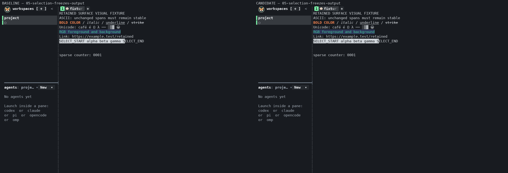
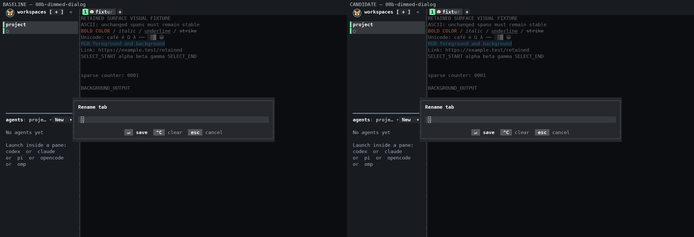
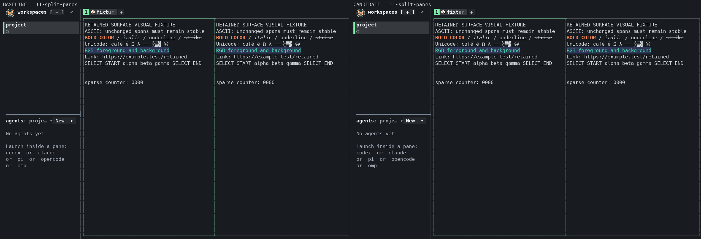
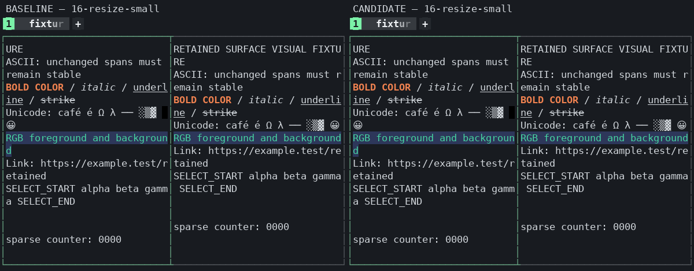

# Terminal performance PR evidence

The [CPU summary](cpu-summary.json) is an unchanged copy of the frozen result
for candidate `a7db85cbe9fe4c8af518404ff825b2c012c601c7` versus main
`815313769575425029472d24479334d741f90452`. See the
[report](../../main_baseline_comparison.md) for the workload, CPU table and
limitations. Paths embedded in that summary and report refer to local raw
artifacts; those logs and binaries are not included here.

[PR validation](validation.json) describes source
`c61e10269bd1ac0d7f94d41f124306fa26d2f2ef`, after merging main
`a1e9b7d6e6f0ce8db438092358e50daeb5e2a289`: 2,204 unit passes, one skip,
typecheck/format and production/test builds passed. The five affected
integration suites passed 72 cases with one skip and no retries. These builds
reuse the unchanged native assets tested before the merge. The full CPU matrix
and full integration suite were not repeated after the merge.

All 19 real-PTY states match updated main in styled cells, hyperlink
destinations, cursor and decoded image placements/pixels; all 19 PNG hashes
match. Opaque image/link IDs are excluded. The images below show main on the
left and the candidate on the right. Split panes and the small resize were
also visually inspected.

| Selection freezes output | Dimmed dialog |
| --- | --- |
|  |  |

| Split panes | Small resize |
| --- | --- |
|  |  |
