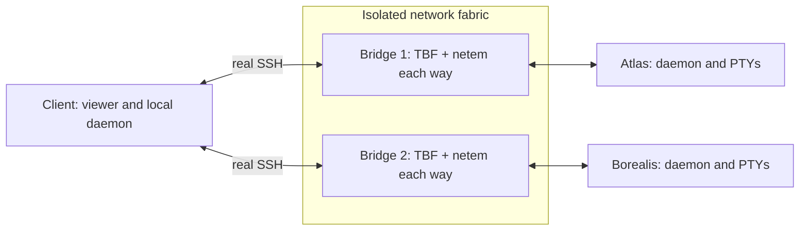

# Reproduce the remote-network evaluation

For new runs, use the [external cache and artifact workflow](../ARTIFACTS.md).
The optional output argument now defaults to a fresh cache directory. Explicit
outputs must be outside this checkout. Replace historical data/output paths
below with cache paths. Historical evidence remains until R2 migration finishes.

The [comparison report](report.md) is the short entry point. This directory
contains an external network and terminal harness. It does not patch Corgi or
Herdr, replace either transport, or inject hooks into application code.

## What runs

Three private Linux network namespaces represent a client, `atlas`, and
`borealis`. Each has its own application daemon, HOME, XDG directories and
project. A fourth namespace contains two isolated bridges between their veth
interfaces. Real OpenSSH carries
the product's normal saved-machine connections. A private SSH configuration,
throwaway host/client keys, and an sshd `ForceCommand` select the isolated
environment. The application binaries are identical on client and servers.

Only the intermediate bridge's outgoing ports receive traffic-control rules.
Each direction has a token-bucket bandwidth limiter (`tbf`) and a child
`netem` queue for delay/loss. Sender TCP queues are outside the impairment.
The host's interfaces,
routes, firewall, SSH configuration and running application sessions are not
changed. The harness removes its processes, namespaces, keys and temporary
runtime on exit; SSH logs, terminal recordings and workload receipts are retained.



Each machine has four independent terminal workloads. One remote pane is
visible; three panes on that machine and all panes on the other remote continue
writing. The selected PTY is **132 × 47** in both products (outer viewers are
160 × 48 for Corgi and 159 × 48 for Herdr). Unvisited background panes retain
each product's defaults. This is a transport/product comparison, not an
agent-inference or terminal-engine CPU comparison.

The sparse workload redraws a build-progress screen at 20 Hz, changing a job
row, its previous row, a sequence/timestamp header and a receipt footer. The
dense stress workload changes 22 × 108 printable random characters at 20 Hz.
The same seeded producer runs for both products. The dense case represents a
rapidly changing screen; it is not a typical chat transcript. No models,
provider accounts, internet access or paid services are involved.

The follow-up harness keeps the producer's PTY blocking and completes partial
writes. Setting stdin nonblocking can also affect stdout when both share the
same open-file description. An early follow-up pilot exposed that failure under
local PTY pressure. Stream results now record all twelve producer PIDs and
their liveness; a producer exit marks the trial invalid. Workload text, cadence,
network shaping and measurement definitions are unchanged.

`observe.ts` runs the actual viewer in a PTY and feeds its output into Ghostty's
terminal emulator. A marker is accepted only when header and footer sequences
agree. The observer and producer explicitly use Linux `CLOCK_MONOTONIC`;
Bun's process-relative `hrtime` is not used. This avoids clock synchronization
error between simulated machines.

The PTY observer does not answer terminal theme/capability probes, so each
product's fallback probe wait is included in attach timing. A physical terminal
that answers promptly can have a smaller local-startup component. Both use
the same observer behavior; reported WAN results are total observed attach
times, not isolated SSH-handshake times.

## Prerequisites and pinned inputs

Use Linux with `sudo -n`, `ip`, `tc`, `ss`, `ethtool`, `ssh`, `sshd`,
`ssh-keygen`, `setpriv`, `taskset`, Python 3 and Bun. On Debian/Ubuntu, the
network tools come from `iproute2`, `openssh-client`, `openssh-server`,
`ethtool`, `util-linux` and `iputils-ping`. No Docker or Python packages are
needed. The caller remains an ordinary user; sudo creates/manages namespaces
and launches their processes before dropping privileges.

The Corgi application under test is `design/remote-attempt-2` at
`eeef7b27` (see the full SHA and binary/native hashes in the evidence).
Build using the repository's pinned Zig wrapper, through the normal build:

```sh
cd /home/t/dev/personal/corgi-remote-network-eval
bun install --frozen-lockfile
bun build.ts
```

Herdr is the unmodified official Linux x86_64
[v0.9.5 release](https://github.com/herdrdev/herdr/releases/tag/v0.9.5), source
commit `2ecf19a92fc3a7fff75b6ce3655ef04f4625ec01`.

```sh
mkdir -p /tmp/cne-binaries
curl -fL https://github.com/herdrdev/herdr/releases/download/v0.9.5/herdr-linux-x86_64 \
  -o /tmp/cne-binaries/herdr
chmod +x /tmp/cne-binaries/herdr
sha256sum /tmp/cne-binaries/herdr
```

Expected Herdr SHA-256:
`14d9e8bc8b4a9e0118d77c32266f76d461f09b40342eb23752960bd89f59929d`.
Do not set `HERDR_REMOTE_BINARY`: Herdr treats that variable as an installation
override. The harness puts the official binary on the isolated remote PATH.
Herdr's daemon is detached with `setsid` and null stdio, as its own normal
daemon launcher does; this is required by saved-machine setup.

Builds, downloads, machine registration, host-key provisioning and workload
creation are outside measured startup. Daemons are already running when an
attach starts. “Cold” means no existing SSH master; “warm” retains the product's
own master after a previous attachment. It does not mean a cold disk cache or
first installation.

## Run

Always choose a **new** trial output directory. Coordinators can append distinct
trial directories to the same result root. Runtime sockets use a short,
automatically created `/tmp/cne-PID` path regardless of output directory.
All normal runs acquire the repository's shared benchmark lock. Applications
use CPUs 32–39 by default; select available CPUs with `--cpus` on another host.

```sh
# Short end-to-end check, including independent TCP and ICMP calibration.
python3 tools/benchmarks/remote_network/run.py \
  corgi dist/corgi /tmp/cne-check-corgi --calibrate
python3 tools/benchmarks/remote_network/run.py \
  herdr /tmp/cne-binaries/herdr /tmp/cne-check-herdr

# Three alternating blocks of startup, faults and bandwidth tests.
python3 tools/benchmarks/remote_network/batch.py \
  dist/corgi /tmp/cne-binaries/herdr /tmp/cne-matrix

# Real elapsed-time 3-minute and 11-minute client suspensions.
python3 tools/benchmarks/remote_network/sleep_pair.py \
  dist/corgi /tmp/cne-binaries/herdr /tmp/cne-matrix
```

The sleep coordinator reserves the benchmark lock for the whole pair. The two
products run concurrently on separate CPU sets (32–39 and 48–55); it does not
run alongside the main matrix. Both sets must exist. Change these placements
in `sleep_pair.py` on a smaller host. Sleep results are individual recovery
observations, not a distribution or a CPU benchmark.

Useful focused runs:

```sh
# Reopening cached workspaces early; captures startup crashes as failed attempts.
python3 tools/benchmarks/remote_network/run.py corgi dist/corgi \
  /tmp/cne-early-click --suite startup --rtts 120,300 --repeats 3

# One suite, three repetitions.
python3 tools/benchmarks/remote_network/run.py corgi dist/corgi \
  /tmp/cne-faults --suite faults --repeats 3

# Diagnose SSH compression without changing the application.
python3 tools/benchmarks/remote_network/run.py corgi dist/corgi \
  /tmp/cne-compressed --suite stream --repeats 3 --ssh-compression yes \
  --stream-cases sparse:1mbit,sparse:256kbit,sparse:64kbit

# Produce machine-readable aggregates from completed trials.
python3 tools/benchmarks/remote_network/summarize.py /tmp/cne-matrix \
  --output /tmp/cne-summary.json

# Check the full matrix, clock/geometry invariants, calibration and cleanup.
python3 tools/benchmarks/remote_network/audit.py /tmp/cne-matrix \
  --output /tmp/cne-audit.json

# Export the comparison tables and per-trial CSV into a separate directory.
python3 tools/benchmarks/remote_network/tables.py /tmp/cne-summary.json \
  /tmp/cne-tables
```

For deliberate exclusions, supply `--exclude reasons.json`, a JSON object
mapping trial-directory names to explanations. Never silently remove a failed
startup: the reducer retains failures separately from successful latencies.
A recorded startup failure does not abort the block, so a zero runner exit
code does not mean every application attempt succeeded. Inspect `failures` in
the summary. The batch coordinator also continues after a child failure;
`execution.jsonl` records those exit codes, and `audit.py` checks completeness.

## Scenarios and definitions

| Scenario | Injection | Measurement |
| --- | --- | --- |
| Connection init | 0/20/120/300 ms RTT; cold and warm SSH | Process launch to matching remote marker, then to first acknowledged input probe |
| Broken TCP connection | `ss -K` on atlas's established SSH sockets | Fault applied to a fresh marker and acknowledged input |
| Short / longer outage | 100% packet loss both ways for 3 / 15 seconds | Restore to fresh marker and acknowledged input |
| One-way outage | 100% downstream loss for 15 seconds | Same, plus a receipt for input typed during the outage |
| One machine isolated | 30-second atlas outage | Local and borealis navigation/echo while atlas is unavailable, then atlas recovery |
| Limited bandwidth | 1 Mbit/s, 256 kbit/s, 64 kbit/s, each direction | 30-second freshness/cadence/input sample; lift cap while workload continues and time catch-up |
| Loss and jitter | 120 ms nominal RTT, 10 ms normal jitter per direction, independent 1% loss per direction | Freshness, echo, traffic and recovery |
| Client sleep | SIGSTOP client namespace processes for 180 / 660 seconds; both links blackholed; old server-side TCP sockets destroyed | Wake to fresh marker and acknowledged input; remote producer continuity and pending-input receipt |

Fault/throughput cases have an equal five-second attachment settling period;
startup cases intentionally click a saved workspace as soon as it is visible.
Startup failures are retained in the comparison.
Each fault/throughput case uses a new viewer and fresh SSH masters so one
scenario's retry backoff does not contaminate the next.

The emulated bottleneck queues hold at most 64 packets per direction. TBF uses a 1,600-byte burst;
offloads are disabled on every veth endpoint. Rules explicitly reset rate,
loss and jitter on every transition. “Unlimited” sets a 100 Gbit/s ceiling.
Rate limiting is separate from netem delay so removing a bandwidth cap does
not retain old per-packet transmission deadlines from
[netem's rate model](https://github.com/torvalds/linux/blob/v6.8/net/sched/sch_netem.c).
The [netem manual](https://www.man7.org/linux/man-pages/man8/netem.8.html)
recommends receiver-side placement for realistic TCP behavior because of
sender TCP Small Queues. Here, packets traverse netem on the intermediate
port immediately before entering the receiver's interface. The independent
TCP test validates achieved payload rate, and ICMP validates RTT. Queueing
adds latency at limited rates; the 64-packet queue is one chosen bottleneck,
not a model of every access network.
Loss/jitter draws are stochastic, not a repeatable packet-by-packet trace.

* **Fresh marker:** generated after the restore/wake boundary and received
  within 500 ms of generation. This prevents queued pre-outage output from
  counting as recovery. It checks matching terminal markers, not every cell's
  visual fidelity.
* **Usable:** a unique input line sent through the viewer is acknowledged in
  remote terminal output. Readiness probes are 100 ms apart; they add sampling
  granularity and a round trip. They can expose a screen appearing before input
  becomes enabled. They are not local predictive rendering.
* **Screen age:** elapsed time since the source timestamp currently displayed,
  sampled every 50 ms, including frozen periods. Merely taking the ages of
  arriving frames would hide stalls. Reported p95 values are within-trial time
  percentiles, not confidence intervals over independent trials.
* **Input:** five unique lines during each fixed 30-second bandwidth window.
  Missing visible replies remain failures. Durable remote receipts separately
  show whether those lines executed, executed later, or executed more than once.
  Outage cases also type at two seconds, and the 15-second cases type again at
  eight seconds with a saved screen showing whether input was paused.
* **Traffic:** bytes delivered at the receiving interface, including TCP/SSH
  traffic and retransmissions, divided by actual counter-sampling intervals.
  This is not application payload size. Summary fields `tx_kbit_s` and
  `rx_kbit_s` mean server-to-client and client-to-server respectively.
  CPU ticks and RSS for namespace processes are retained roughly once per second.

The sleep scenario first blocks downstream traffic, sends a unique line, then
stops the client and severs the old connections. This leaves a potentially
unacknowledged operation to inspect after recovery. For Corgi, severing at the
start also lets the 660-second case cross its ten-minute detached-link lifetime.
The durable receipt is the authority on duplicate execution.
Process samples verify that the same eight remote producers remain alive and
accumulate CPU time during the freeze; visible source sequences also establish
how far the workload advanced while the client could not observe it.

## Evidence and cleanup

Every trial retains `manifest.json` (binary SHA, machine, options),
`harness.json` plus the exact harness sources, `results.json`, timestamped
`events.jsonl`, per-viewer JSONL and raw ANSI, SSH commands/sshd logs,
network queue/socket/counter snapshots, process RSS/CPU samples, and remote
input/source receipts under `runtime/`. `execution.jsonl` records order and
exit statuses for a batch. The report links a compact summary and retained
raw evidence; measurements can be recalculated from the raw observations.
Archived viewer specs contain the original ephemeral paths. Reproduce with
`run.py`, which creates fresh environments and keys.

This run's [raw archive](../../../dist/remote-network-20261106/raw.tar.gz) and
unpacked captures live under the ignored `dist/remote-network-20261106/`
directory. Copy the archive with the report when sharing it. The
[archive checksum](evidence/artifact.json), compact JSON, trial CSV, binary
provenance and validation records live in `evidence/` beside this harness.

Ctrl+C normally runs cleanup. If the runner is killed without cleanup, read
its `setup` event for the **exact four namespace names**, use
`sudo ip netns pids NAME` to list only their processes, continue any stopped
processes, terminate those PIDs, and then `sudo ip netns delete NAME` for each.
Do not use a global `pkill` from inside a network namespace: its process view
is still shared with the host.

## Limits

These are repeatable synthetic faults on one Linux host, not measurements of
internet routes or a physical laptop's suspend/resume stack. SIGSTOP plus
lost connections tests application suspension and network replacement; it does
not emulate Linux suspend's clock behavior, Wi-Fi authentication, VPN/DNS
changes, key-agent locking or OS power-management events. The host kernel and
TCP timers continue during SIGSTOP, unlike hardware suspend; monotonic time
also advances. These are application-freeze recovery measurements, not a
prediction of physical laptop wake latency. Independent veth
bottlenecks do not model two machines competing for one shared last-mile queue.
No file transfer, image paste, live agent transcript, auth expiry, remote daemon
restart or cross-platform claim follows from these results. Small sample counts
support the observed differences and reproductions, not population reliability
percentages.
